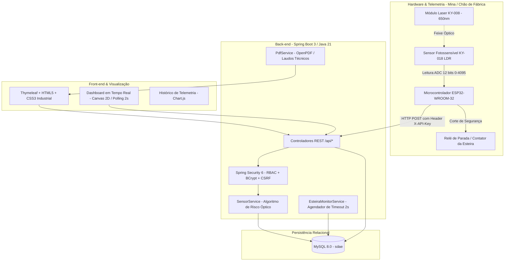

# SDAE — Sistema de Detecção e Automação de Esteiras

Sistema industrial integrado de monitoramento e automação de esteiras transportadoras de bauxita, combinando telemetria IoT via **ESP32**, feixe óptico de alinhamento (**Laser KY-008 + LDR KY-018**) e plataforma web em **Spring Boot 3** com arquitetura em camadas, auditoria RBAC e relatórios automatizados.

---

## 🏗 Arquitetura do Sistema



---

## ⚡ Principais Funcionalidades

1. **Telemetria Óptica em Tempo Real:**
   * Leitura contínua da intensidade do feixe laser (ADC 0–4095).
   * Detecção de passagem de carga e detecção de desalinhamento severo.
2. **Monitoramento de Timeout e Paradas:**
   * `EsteiraMonitorService` em background com checagem a cada 2 segundos.
   * Transição automática para `STOPPED` ou `OFFLINE` com registro histórico auditável.
3. **Controle de Acesso Baseado em Perfis (RBAC):**
   * 4 níveis: `ADMINISTRADOR`, `ENGENHEIRO`, `TECNICO` e `OPERADOR`.
   * Criptografia forte de senhas com **BCrypt**.
   * Proteção anti-força bruta (`BruteForceProtectionFilter`) com bloqueio temporário (HTTP 429).
4. **Dashboard e Emissão de Laudos:**
   * Painel operacional em tempo real com taxa de atualização de 2 segundos.
   * Geração e exportação instantânea de relatórios técnicos de operação em PDF (OpenPDF).

---

## 🚀 Como Executar o Projeto Localmente

### Pré-requisitos
* **Java 21** ou superior
* **Maven 3.9+** (ou utilizar o wrapper incluso `./mvnw`)
* **MySQL 8.0+**

### 1. Clonar o Repositório
```bash
git clone https://github.com/Dev-SdaeEsteira/Sistema-de-monitoramento-de-esteiras.git
cd Sistema-de-monitoramento-de-esteiras
```

### 2. Configurar o Banco de Dados
Crie o banco de dados no MySQL:
```sql
CREATE DATABASE sdae CHARACTER SET utf8mb4 COLLATE utf8mb4_unicode_ci;
```

As credenciais do banco podem ser configuradas no arquivo `src/main/resources/application.properties` ou passadas via variáveis de ambiente:
```properties
spring.datasource.url=jdbc:mysql://localhost:3306/sdae?createDatabaseIfNotExist=true
spring.datasource.username=root
spring.datasource.password=sua_senha
```

### 3. Executar a Aplicação
No Windows (Prompt ou PowerShell):
```cmd
.\mvnw.cmd spring-boot:run
```

No Linux / macOS:
```bash
./mvnw spring-boot:run
```

A aplicação iniciará na porta **8080**:
* **Landing Page:** [http://localhost:8080/](http://localhost:8080/) ou [http://localhost:8080/welcome](http://localhost:8080/welcome)
* **Login do Sistema:** [http://localhost:8080/login](http://localhost:8080/login)

---

## 👥 Credenciais Padrão para Demonstração

O sistema inicializa automaticamente os seguintes usuários no ambiente de desenvolvimento:

| Perfil | E-mail / Login | Senha | Acesso / Permissões |
|---|---|---|---|
| **Administrador** | `admin@sdae.com.br` | `admin123` | Acesso total, auditoria, CRUD de funcionários e configurações |
| **Engenheiro** | `carlos@sdae.com.br` | `eng123` | Gestão de esteiras, calibração de sensores e manutenção |
| **Operador** | `gustavo@sdae.com.br` | `op123` | Visualização do dashboard operacional, leituras e alertas |

---

## 📡 Integração com Firmware ESP32

O firmware para o ESP32 encontra-se na pasta [`/esp32`](./esp32).

### Envio de Leituras
* **Método:** `POST`
* **URL:** `/api/sensores/{id}/leitura`
* **Header:** `X-API-Key: <CHAVE_GERADA_DO_SENSOR>`
* **Content-Type:** `application/json`
* **Payload:**
```json
{
  "valorLdr": 1820,
  "laserDetectado": true,
  "pulsoDetectado": true
}
```

---

## 🧪 Testes Automatizados

Para executar toda a suíte de testes de integração, segurança e regras de negócio:
```cmd
.\mvnw.cmd test
```

---

## 📄 Licença
Projeto desenvolvido para fins técnico-acadêmicos (TCC / Automação e Engenharia de Software).
