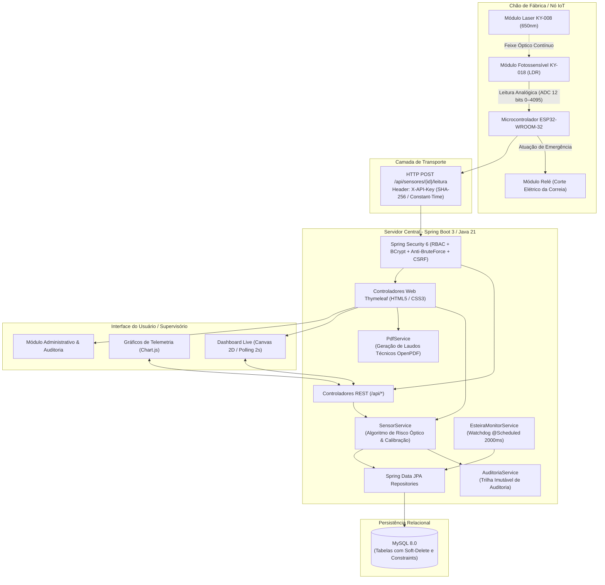
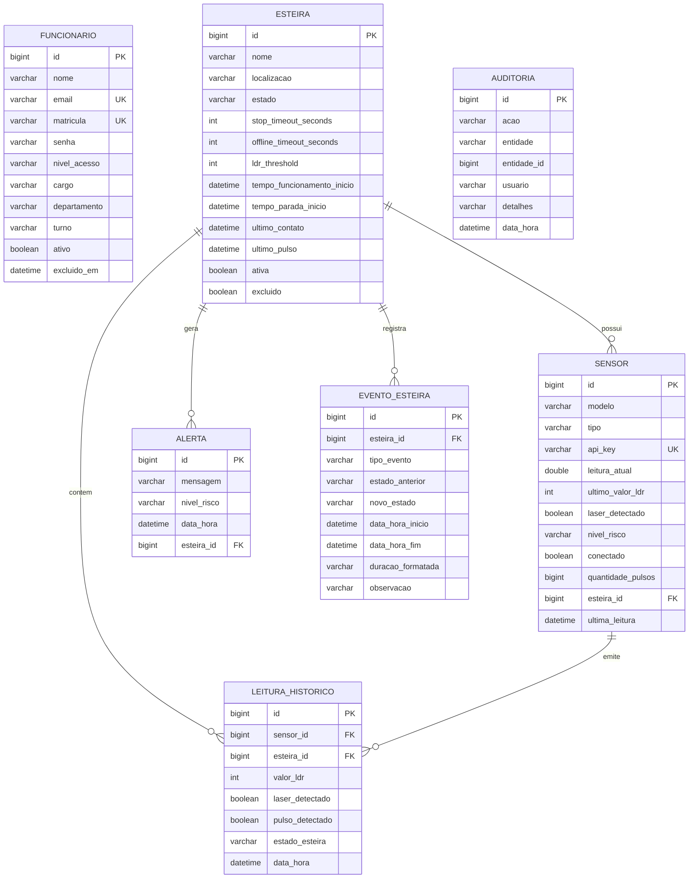

# SDAE — Sistema de Detecção e Automação de Esteiras

<div align="center">


<p align="center">
  <strong>Solução ciberfísica integrada para monitoramento contínuo, telemetria óptica e parada emergencial de esteiras transportadoras industriais.</strong>
</p>

</div>

---

## 📋 Sumário
1. [Visão Geral & Contexto Industrial](#-visão-geral--contexto-industrial)
2. [Arquitetura da Solução](#-arquitetura-da-solução)
3. [Especificação do Hardware & IoT](#-especificação-do-hardware--iot)
4. [Pilares de Engenharia de Software](#-pilares-de-engenharia-de-software)
5. [Modelagem de Dados (ERD)](#-modelagem-de-dados-erd)
6. [Catálogo de Endpoints REST & Rotas](#-catálogo-de-endpoints-rest--rotas)
7. [Como Executar o Projeto](#-como-executar-o-projeto)
8. [Perfis de Acesso & Credenciais Padrão](#-perfis-de-acesso--credenciais-padrão)
9. [Roteiro de Demonstração para Banca](#-roteiro-de-demonstração-para-banca)
10. [Testes Automatizados](#-testes-automatizados)

---

## 🏭 Visão Geral & Contexto Industrial

No setor de mineração e metalurgia (em especial no transporte contínuo de **bauxita**), as esteiras transportadoras são ativos críticos. Paradas não planejadas, rompimento de correia, desalinhamento transversal ou acúmulo excessivo de material geram custos de manutenção da ordem de centenas de milhares de reais e riscos iminentes à segurança dos operadores.

O **SDAE** foi desenvolvido para resolver este problema unindo:
* **Chão de Fábrica (IoT):** Microcontrolador **ESP32** com sensor laser (**KY-008**) e fotossensível (**KY-018 LDR**) em amostragem contínua para inspecionar o alinhamento da esteira e a cadência de passagem de carga.
* **Camada de Borda & Segurança:** Controle imediato de acionamento/corte elétrico de motor via relé de segurança e autenticação de dispositivo por cabeçalho criptográfico `X-API-Key`.
* **Servidor Central (Back-end):** Aplicação robusta em **Spring Boot 3 (Java 21)** com arquitetura em camadas, agendador automático de timeouts (*watchdog*), controle de acesso por papéis (**RBAC**) e auditoria persistida.
* **Supervisório Operacional (Front-end):** Dashboard em tempo real atualizado via polling assíncrono, mapas de esteiras, gráficos de telemetria histórica e emissão de laudos periciais em **PDF**.

---

## 🏗 Arquitetura da Solução

O sistema adota uma arquitetura em camadas orientada a serviços (MVC + REST), desacoplando a ingestão de telemetria dos nós IoT das interfaces de visualização corporativa:



---

## 🔌 Especificação do Hardware & IoT

O nó de sensoriamento é baseado em eletrônica embarcada de baixo custo e alta precisão:

| Componente | Função no Sistema | Pino ESP32 | Especificação Técnica |
|---|---|---|---|
| **ESP32-WROOM-32** | Processamento de borda, calibração e envio HTTP | — | Dual Core 240MHz, Wi-Fi 802.11 b/g/n, ADC 12 bits |
| **Laser KY-008** | Emissor óptico de feixe focalizado | `GPIO 23` | Comprimento de onda 650nm (vermelho), 5V, 5mW |
| **LDR KY-018** | Receptor óptico de intensidade luminosa | `GPIO 34 (ADC1)` | Divisor de tensão com resistor pull-down de 10kΩ |
| **Módulo Relé 5V** | Interrupção imediata do contator do motor | `GPIO 22` | Contatos NA/NF, acionamento por nível lógico |
| **LED Indicador** | Status visual da conexão Wi-Fi / Feixe | `GPIO 2` | LED SMD onboard |

### Algoritmo de Borda do ESP32
1. O laser emite um feixe contínuo alinhado com o sensor LDR no lado oposto da correia.
2. Em operação normal, o feixe atinge o LDR com intensidade máxima (leitura ADC ~ 2500 a 4095).
3. Quando a correia ou carga passa, o feixe é cortado momentaneamente (**pulso detectado**).
4. Se o feixe ficar interrompido prolongadamente sem retornar (desalinhamento lateral, esteira descalçada ou acúmulo de pó), o nó sinaliza anomalia e o back-end classifica o risco como **CRÍTICO**.

---

## 🛡 Pilares de Engenharia de Software

### 1. Máquina de Estados Finita da Esteira (*Watchdog de Timeout*)
O serviço agendado [`EsteiraMonitorService`](src/main/java/com/cba/sdae/service/EsteiraMonitorService.java) roda a cada **2 segundos** de forma não-bloqueante no servidor:
* **RUNNING (🟢 Em Operação):** Recebendo pulsos ópticos regulares dentro do `stopTimeout` (15 segundos).
* **STOPPED (🔴 Parada):** Pulsos cessaram por mais de 15 segundos. O sistema grava um registro de transição e dispara alerta com duração calculada.
* **OFFLINE (⚫ Sem Comunicação):** Nenhum pacote HTTP recebido do ESP32 por mais de `offlineTimeout` (15 segundos).
* **MAINTENANCE (🟡 Manutenção):** Modo manual engatilhado por **Engenheiro** ou **Administrador**, congelando os alarmes automáticos durante intervenções físicas.

### 2. Segurança em Profundidade (OWASP & Spring Security 6)
* **RBAC Granular:** 4 perfis estritos (`ADMINISTRADOR`, `ENGENHEIRO`, `TECNICO`, `OPERADOR`).
* **Criptografia Forte:** Senhas salvas com hash **BCrypt** (10 rounds de salt).
* **Proteção contra Timing Attacks:** A autenticação das chaves de API do ESP32 utiliza `MessageDigest.isEqual(...)`, executando a comparação em tempo constante para mitigar ataques de temporização.
* **Filtro Anti-Força Bruta:** [`BruteForceProtectionFilter`](src/main/java/com/cba/sdae/filter/BruteForceProtectionFilter.java) bloqueia IPs após 5 tentativas inválidas de login consecutivas, retornando código **HTTP 429 (Too Many Requests)**.
* **Anti-IDOR:** A troca de senha no perfil exige autenticação da sessão corrente e checa se o ID pertence ao usuário logado.
* **Cabeçalhos HTTP Reforçados:** Proteção contra Clickjacking (`X-Frame-Options: SAMEORIGIN`), Content Security Policy (CSP), proteção anti-MIME sniffing e CSRF sincronizado com cookies `Lax`.

### 3. Integridade e Soft-Delete sem Erro 500
Todas as entidades do banco utilizam deleção lógica (`ativo = false`, `excluido_em`). Para evitar que consultas aninhadas do Hibernate disparem `EntityNotFoundException` ao buscar registros históricos associados a esteiras desativadas, os relacionamentos `@ManyToOne` utilizam:
```java
@NotFound(action = NotFoundAction.IGNORE)
```
Garantindo listagem limpa de históricos órfãos sem interrupção de serviço.

---

## 🗄 Modelagem de Dados (ERD)



---

## 🌐 Catálogo de Endpoints REST & Rotas

### Ingestão IoT & Telemetria
| Método | Endpoint | Acesso | Descrição |
|---|---|---|---|
| `POST` | `/api/sensores/{id}/leitura` | `X-API-Key` | Envio de telemetria analógica do ESP32 |
| `GET` | `/api/sensores/{id}/historico` | Autenticado | Últimas leituras do sensor com limite configurável |
| `GET` | `/api/sensores/leituras` | Autenticado | Listagem paginada de leituras com filtros |
| `POST` | `/api/sensores/{id}/rotacionar-api-key` | `ENGENHEIRO`, `ADMIN` | Gera novo token criptográfico para o sensor |

### Monitoramento & Operação
| Método | Endpoint | Acesso | Descrição |
|---|---|---|---|
| `GET` | `/dashboard` | Autenticado | Interface supervisória em tempo real |
| `GET` | `/api/dashboard` | Autenticado | JSON consolidado com KPIs, estados e níveis de risco |
| `POST` | `/esteiras/{id}/manutencao` | `ENGENHEIRO`, `ADMIN` | Alterna modo de manutenção física da esteira |
| `GET` | `/relatorios/exportar-pdf` | Autenticado | Download do laudo pericial consolidado em PDF |

### Gestão & Administração
| Método | Endpoint | Acesso | Descrição |
|---|---|---|---|
| `GET` | `/admin` | `ADMINISTRADOR` | Painel de controle de funcionários e auditoria |
| `POST` | `/admin/salvar` | `ADMINISTRADOR` | Cadastro/Edição de colaboradores e papéis |
| `POST` | `/admin/deletar/{id}` | `ADMINISTRADOR` | Soft-delete de usuário com proteção ao último admin |

---

## 🚀 Como Executar o Projeto

### Pré-requisitos
* **Java Development Kit (JDK) 21** ou superior
* **MySQL Server 8.0+**
* Git instalado

### 1. Clonar o Repositório
```bash
git clone https://github.com/Dev-SdaeEsteira/Sistema-de-monitoramento-de-esteiras.git
cd Sistema-de-monitoramento-de-esteiras
```

### 2. Configurar o Banco de Dados MySQL
Acesse o MySQL e crie o esquema do banco de dados:
```sql
CREATE DATABASE sdae CHARACTER SET utf8mb4 COLLATE utf8mb4_unicode_ci;
```

As propriedades de conexão estão configuradas em [`src/main/resources/application.properties`](src/main/resources/application.properties). Você pode sobrescrevê-las no arquivo ou exportar variáveis de ambiente:
```properties
spring.datasource.url=jdbc:mysql://localhost:3306/sdae?createDatabaseIfNotExist=true
spring.datasource.username=root
spring.datasource.password=Senai@499
```

### 3. Compilar e Iniciar a Aplicação
Utilize o Maven Wrapper incluso no projeto (não necessita instalação prévia do Maven):

**No Windows (PowerShell / Prompt de Comando):**
```cmd
.\mvnw.cmd spring-boot:run
```

**No Linux ou macOS:**
```bash
chmod +x mvnw
./mvnw spring-boot:run
```

O servidor inicializará na porta **`8080`**:
* **Apresentação do Projeto:** [http://localhost:8080/](http://localhost:8080/) ou [http://localhost:8080/welcome](http://localhost:8080/welcome)
* **Login do Sistema:** [http://localhost:8080/login](http://localhost:8080/login)

---

## 👥 Perfis de Acesso & Credenciais Padrão

O sistema possui uma rotina de *seed* automático ([`DataSeeder`](src/main/java/com/cba/sdae/config/DataSeeder.java)) que cria os usuários fundamentais caso o banco de dados esteja vazio:

| Perfil | E-mail / Login | Senha | Atribuições Principais |
|---|---|---|---|
| **Administrador** | `admin@sdae.com.br` | `admin123` | Gestão de equipe, logs de auditoria, exclusão e visualização total |
| **Engenheiro** | `carlos@sdae.com.br` | `eng123` | Cadastro de esteiras/sensores, rotação de chaves e modo manutenção |
| **Operador** | `gustavo@sdae.com.br` | `op123` | Supervisão em tempo real, acompanhamento de alertas e leituras |

---

## 🎯 Roteiro de Demonstração para Banca

Para apresentar o projeto com excelência em menos de 10 minutos:

1. **Apresentação Geral (Landing Page):**
   * Abra [http://localhost:8080/welcome](http://localhost:8080/welcome) e destaque a contextualização industrial, pilares de tecnologia e responsividade.
2. **Controle de Acesso (RBAC):**
   * Faça login com `gustavo@sdae.com.br` (Operador). Mostre que o menu "Administração" não é exibido e que botões de manutenção/chave de API ficam ocultos.
   * Faça logout e entre com `admin@sdae.com.br` (Administrador). Demonstre o acesso total.
3. **Dashboard em Tempo Real & Telemetria:**
   * Abra a tela `/dashboard`. Mostre os KPIs dinâmicos, o canvas com animação da correia e o gráfico LDR.
4. **Simulação de Telemetria IoT via cURL (Efeito Demonstração Seguro):**
   * Envie uma leitura simulando o ESP32 enviando feixe normal:
     ```bash
     curl -X POST http://localhost:8080/api/sensores/1/leitura \
       -H "Content-Type: application/json" \
       -H "X-API-Key: sua-chave-aqui" \
       -d '{"valorLdr": 1820, "laserDetectado": true, "pulsoDetectado": true}'
     ```
   * Em seguida, envie uma leitura com o feixe cortado (`"laserDetectado": false`) e veja o alerta crítico e a esteira alterando o status em tempo real.
5. **Emissão de Laudo Técnico:**
   * Navegue até `/relatorios` e clique em **"Exportar PDF Completo"**. Demonstre o relatório corporativo estruturado com tabelas, cabeçalhos oficiais e indicadores formatados pelo OpenPDF.

---

## 🧪 Testes Automatizados

O projeto conta com **36 testes automatizados** abrangendo controladores REST, regras de transição de estado da esteira, autenticação Spring Security e isolamento de soft-delete.

Para rodar todos os testes:
```cmd
.\mvnw.cmd test
```

Resultado esperado:
```text
[INFO] Results:
[INFO] Tests run: 36, Failures: 0, Errors: 0, Skipped: 0
[INFO] BUILD SUCCESS
```

---

## 🎓 Ficha Técnica Acadêmica
* **Instituição:** SENAI
* **Projeto:** TCC / Projeto Integrador — Sistema de Detecção e Automação de Esteiras (SDAE)
* **Público-Alvo:** Indústria 4.0, Mineração de Bauxita e Automação Industrial
* **Licença:** MIT / Acadêmica
