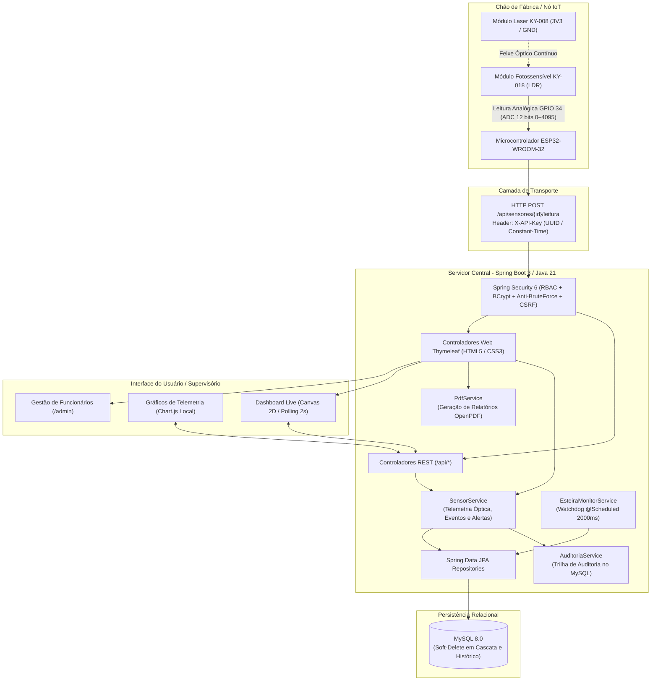
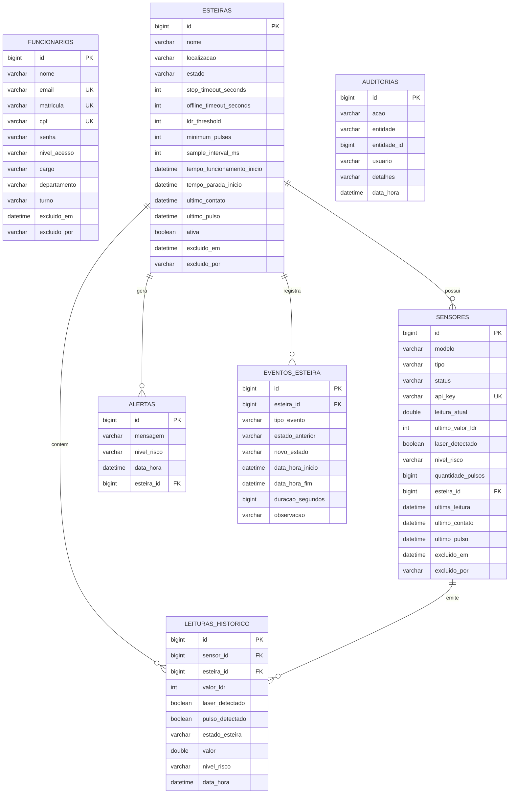

# SDAE — Sistema de Detecção e Automação de Esteiras

<div align="center">


<p align="center">
  <strong>Solução ciberfísica integrada para monitoramento contínuo, telemetria óptica em tempo real e detecção automática de paradas em esteiras transportadoras industriais.</strong>
</p>

</div>

---

## 📋 Sumário
1. [Visão Geral & Contexto Industrial](#-visão-geral--contexto-industrial)
2. [Arquitetura da Solução](#-arquitetura-da-solução)
3. [Especificação do Hardware & IoT](#-especificação-do-hardware--iot)
4. [Pilares de Engenharia de Software](#-pilares-de-engenharia-de-software)
5. [Modelagem de Dados (ERD)](#-modelagem-de-dados-erd)
6. [Catálogo de Endpoints REST & Rotas](#-catálogo-de-endpoints-rest--rotas)
7. [Como Executar o Projeto](#-como-executar-o-projeto)
8. [Perfis de Acesso & Credencial Inicial](#-perfis-de-acesso--credencial-inicial)
9. [Roteiro de Demonstração para Banca](#-roteiro-de-demonstração-para-banca)
10. [Testes Automatizados](#-testes-automatizados)

---

## 🏭 Visão Geral & Contexto Industrial

No setor de mineração e metalurgia (em especial no transporte contínuo de **bauxita**), as esteiras transportadoras são ativos críticos. Paradas não planejadas, rompimento de correia, desalinhamento transversal ou perda de movimento geram custos elevados de manutenção e riscos operacionais.

O **SDAE** resolve esse problema unindo:
* **Chão de Fábrica (IoT):** Microcontrolador **ESP32** com emissor laser (**KY-008**) e receptor fotossensível (**KY-018 LDR**) amostrando a **40 Hz (25 ms)** com histerese e debounce para detectar pulsos de movimento e interrupções no feixe.
* **Autenticação de Dispositivo:** Envio de telemetria via HTTP `POST` autenticado por chave exclusiva por sensor (`X-API-Key` UUID com comparação em tempo constante).
* **Servidor Central (Back-end):** Aplicação em **Spring Boot 3 (Java 21)** com arquitetura em camadas, watchdog automático (`@Scheduled` a cada 2 s), controle de acesso por papéis (**RBAC**) e trilha de auditoria persistida em MySQL.
* **Supervisório Operacional (Front-end):** Dashboard em tempo real atualizado via polling a cada **2 segundos**, mapa dinâmico de esteiras, gráficos históricos de LDR (com **Chart.js** embarcado localmente para operar também offline) e exportação de relatórios em **PDF**.

---

## 🏗 Arquitetura da Solução

O sistema adota uma arquitetura em camadas orientada a serviços (MVC + REST), desacoplando a ingestão de telemetria dos nós IoT das interfaces de visualização corporativa:



---

## 🔌 Especificação do Hardware & IoT

O nó de sensoriamento é baseado em eletrônica embarcada de baixo custo e amostragem de alta frequência (ver [`esp32/README-ESP32.md`](esp32/README-ESP32.md) e [`esp32/sdae_sensor_esteira/sdae_sensor_esteira.ino`](esp32/sdae_sensor_esteira/sdae_sensor_esteira.ino)):

| Componente | Função no Sistema | Ligação no ESP32 | Especificação Técnica |
|---|---|---|---|
| **ESP32-WROOM-32** | Amostragem 40 Hz, detecção de pulsos e envio HTTP | — | Dual Core 240 MHz, Wi-Fi 802.11 b/g/n, ADC 12 bits |
| **Laser KY-008** | Emissor óptico de feixe contínuo | `VCC → 3V3`, `GND → GND` | Comprimento de onda 650 nm (vermelho) |
| **LDR KY-018** | Receptor óptico de intensidade luminosa | `VCC → 3V3`, `GND → GND`, `AO → GPIO 34 (ADC1)` | Divisor de tensão com leitura analógica `0–4095` |

### Algoritmo de Borda do ESP32
1. No `setup()`, o ESP32 realiza uma leitura inicial do LDR para estabelecer o estado real do feixe (evitando pulso falso no boot).
2. No `loop()`, o LDR é amostrado a cada **25 ms (40 Hz)** com **histerese** (`LDR_THRESHOLD ± 100`) e **debounce de pulso de 150 ms**.
3. A cada **2,5 segundos**, o ESP32 envia um `POST` com `valorLdr`, `laserDetectado` e `pulsoDetectado` autenticado por `X-API-Key`.
4. Se os pulsos cessarem por **15 segundos** (`STOP_TIMEOUT`), a esteira transita para **PARADA (`STOPPED`)** com alerta crítico; se o feixe for interrompido sem pulsos, o risco vai imediatamente para **CRÍTICO** com registro de evento `LASER_LOST` e alerta automático.

---

## 🛡 Pilares de Engenharia de Software

### 1. Máquina de Estados Finita da Esteira (*Watchdog de Timeout*)
O serviço agendado [`EsteiraMonitorService`](src/main/java/com/cba/sdae/service/EsteiraMonitorService.java) roda a cada **2 segundos** no servidor:
* **RUNNING (🟢 Funcionando):** Recebendo pulsos ópticos dentro do `stopTimeoutSeconds` (padrão: **15 segundos**).
* **STOPPED (🔴 Parada):** Pulsos cessaram por `>= 15 segundos`. Registra evento `STOP` com duração e gera alerta crítico.
* **OFFLINE (⚫ Sem Comunicação):** Sem heartbeat HTTP do ESP32 por `> 15 segundos` (`offlineTimeoutSeconds`). Registra evento `OFFLINE` e alerta crítico.
* **MAINTENANCE (🟡 Manutenção):** Modo manual acionado por **Engenheiro** ou **Administrador**, pausando alarmes automáticos durante intervenções físicas.

### 2. Segurança em Profundidade (OWASP & Spring Security 6)
* **RBAC:** 4 perfis (`ADMINISTRADOR`, `ENGENHEIRO`, `TECNICO`, `OPERADOR`), com proteção tanto nos endpoints/controllers quanto nos botões das telas via `sec:authorize`.
* **Criptografia de Senhas:** Hash **BCrypt** em todas as senhas (com migração automática de senhas legadas em texto puro no `DataSeeder`).
* **Proteção contra Timing Attacks:** Validação da `X-API-Key` do ESP32 com `MessageDigest.isEqual(...)` em tempo constante.
* **Filtro Anti-Força Bruta:** [`BruteForceProtectionFilter`](src/main/java/com/cba/sdae/filter/BruteForceProtectionFilter.java) bloqueia após 5 tentativas consecutivas inválidas de login (`HTTP 429`).
* **Cabeçalhos HTTP e CSRF:** `X-Frame-Options: SAMEORIGIN`, CSP, anti-MIME sniffing e proteção CSRF via cookie `XSRF-TOKEN` (`SameSite=Lax`).
* **Páginas de Erro Customizadas:** Template [`error.html`](src/main/resources/templates/error.html) dedicado para `403`, `404` e `500`, evitando exposição da Whitelabel Error Page.

### 3. Integridade e Soft-Delete em Cascata
As entidades principais (`Esteira`, `Sensor`, `Funcionario`) utilizam exclusão lógica (`excluido_em`, `excluido_por`) com `@Where(clause = "excluido_em IS NULL")`. Ao excluir uma esteira, o [`EsteiraService`](src/main/java/com/cba/sdae/service/EsteiraService.java) aplica soft-delete em cascata nos sensores vinculados e registra auditoria. Os históricos (`LeituraHistorico`, `Alerta`, `EventoEsteira`) utilizam `@NotFound(action = NotFoundAction.IGNORE)` para manter integridade de leitura sem erro 500.

---

## 🗄 Modelagem de Dados (ERD)



---

## 🌐 Catálogo de Endpoints REST & Rotas

### Ingestão IoT & Telemetria
| Método | Endpoint | Acesso | Descrição |
|---|---|---|---|
| `POST` | `/api/sensores/{id}/leitura` | `X-API-Key` | Envio de telemetria óptica do ESP32 |
| `GET` | `/api/sensores/{id}/historico` | Autenticado | Últimas leituras do sensor com limite configurável |
| `GET` | `/api/sensores/leituras` | Autenticado | Listagem paginada de leituras com filtros |
| `POST` | `/api/sensores/{id}/rotacionar-api-key` | `ENGENHEIRO`, `ADMIN` | Gera nova chave UUID para o sensor |

### Monitoramento & Operação
| Método | Endpoint | Acesso | Descrição |
|---|---|---|---|
| `GET` | `/dashboard` | Autenticado | Interface supervisória em tempo real (polling 2 s) |
| `GET` | `/api/dashboard` | Autenticado | JSON consolidado com KPIs, esteiras, eventos e alertas |
| `GET` | `/api/dashboard/grafico-ldr` | Autenticado | Série histórica LDR filtrada por período (`5m`, `15m`, `1h`, `24h`) |
| `POST` | `/esteiras/{id}/manutencao` | `ENGENHEIRO`, `ADMIN` | Alterna modo de manutenção física da esteira |
| `GET` | `/relatorios/exportar-pdf` | Autenticado | Download do relatório consolidado em PDF (OpenPDF) |

### Gestão & Administração
| Método | Endpoint | Acesso | Descrição |
|---|---|---|---|
| `GET` | `/admin` | `ADMINISTRADOR` | Painel de gestão de funcionários |
| `POST` | `/admin/salvar` | `ADMINISTRADOR` | Cadastro/edição de colaboradores e papéis |
| `POST` | `/admin/deletar/{id}` | `ADMINISTRADOR` | Soft-delete de usuário com proteção ao último admin |

---

## 🚀 Como Executar o Projeto

### Pré-requisitos
* **Java Development Kit (JDK) 21** ou superior
* **MySQL Server 8.0+**
* Git instalado

### 1. Clonar o Repositório
```bash
git clone https://github.com/Dev-SdaeEsteira/Sistema-de-monitoramento-de-esteiras.git
cd Sistema-de-monitoramento-de-esteiras
```

### 2. Configurar o Banco de Dados MySQL
A URL padrão já inclui `createDatabaseIfNotExist=true` e parâmetros de compatibilidade com MySQL 8 (`allowPublicKeyRetrieval=true&useSSL=false&serverTimezone=America/Sao_Paulo`). Caso deseje usar outra senha/host, exporte as variáveis de ambiente descritas em [`README-SETUP.md`](README-SETUP.md):
```bash
export SPRING_DATASOURCE_URL="jdbc:mysql://localhost:3306/sdae?createDatabaseIfNotExist=true&allowPublicKeyRetrieval=true&useSSL=false&serverTimezone=America/Sao_Paulo"
export SPRING_DATASOURCE_USERNAME="root"
export SPRING_DATASOURCE_PASSWORD="sua_senha_mysql"
```

### 3. Compilar e Iniciar a Aplicação
Utilize o Maven Wrapper incluso no projeto (não necessita Maven instalado globalmente):

**No Windows (PowerShell / Prompt de Comando):**
```cmd
.\mvnw.cmd spring-boot:run
```

**No Linux ou macOS:**
```bash
./mvnw spring-boot:run
```

O servidor inicializará na porta **`8080`**:
* **Landing Page:** [http://localhost:8080/welcome](http://localhost:8080/welcome)
* **Login do Sistema:** [http://localhost:8080/login](http://localhost:8080/login)

---

## 👥 Perfis de Acesso & Credencial Inicial

O [`DataSeeder`](src/main/java/com/cba/sdae/config/DataSeeder.java) **não popula dados fictícios** de esteiras, sensores nem alertas. Quando a tabela de funcionários está completamente vazia, ele cria apenas o **administrador inicial** para permitir o primeiro acesso:

| Perfil | E-mail / Login | Senha inicial | Observação |
|---|---|---|---|
| **Administrador** | `admin@sdae.com.br` | `admin123` | Criado automaticamente apenas se não houver nenhum funcionário no banco |

A partir do painel `/admin` (logado como Administrador), cadastre os demais usuários nos perfis **Engenheiro**, **Técnico** ou **Operador** conforme a necessidade da operação/banca.

---

## 🎯 Roteiro de Demonstração para Banca

Para apresentar o projeto em menos de 10 minutos com dados reais no MySQL:

1. **Apresentação Geral (Landing Page):**
   * Abra [http://localhost:8080/welcome](http://localhost:8080/welcome) e apresente o contexto industrial e a arquitetura IoT + Spring Boot.
2. **Acesso Inicial & Cadastro Real (Administrador):**
   * Entre com `admin@sdae.com.br` / `admin123`.
   * Em `/esteiras/nova`, cadastre uma esteira (ex.: `Esteira Principal 01` — `Setor A`).
   * Em `/sensores/novo`, cadastre um sensor vinculado a essa esteira e copie o **ID** e a **`X-API-Key`** exibidos na tela de edição.
   * Em `/admin`, crie (se ainda não tiver criado) um usuário com perfil **Operador** para demonstrar o RBAC.
3. **Demonstração de Controle de Acesso (RBAC):**
   * Faça logout e entre com o usuário **Operador** cadastrado: mostre que o menu "Administração" e os botões `+ Nova Esteira`, `Editar`, `Excluir` e `Manutenção` ficam ocultos.
   * Retorne para o **Administrador** (ou **Engenheiro**) para o restante da demonstração.
4. **Telemetria em Tempo Real (ESP32 físico ou cURL):**
   * Abra `/dashboard` (atualização automática a cada 2 s).
   * Com o ESP32 ligado — ou simulando via `curl` com o ID e a `X-API-Key` do sensor cadastrado:
     ```bash
     # Movimento normal (coloca a esteira em RUNNING)
     curl -X POST http://localhost:8080/api/sensores/1/leitura \
       -H "Content-Type: application/json" \
       -H "X-API-Key: SUA_API_KEY_AQUI" \
       -d '{"valorLdr": 2200, "laserDetectado": true, "pulsoDetectado": true}'

     # Interrupção do feixe sem pulso (dispara alerta CRÍTICO e evento LASER_LOST imediatamente)
     curl -X POST http://localhost:8080/api/sensores/1/leitura \
       -H "Content-Type: application/json" \
       -H "X-API-Key: SUA_API_KEY_AQUI" \
       -d '{"valorLdr": 120, "laserDetectado": false, "pulsoDetectado": false}'
     ```
   * Mostre os KPIs, a faixa de alerta crítico, o gráfico LDR por período (`5m`, `15m`, `1h`, `24h`) e o histórico de eventos atualizando em tempo real.
5. **Emissão de Relatório Técnico em PDF:**
   * Navegue até `/relatorios` e clique em **"Exportar PDF Completo"** para baixar o relatório gerado pelo OpenPDF.

---

## 🧪 Testes Automatizados

O projeto conta com **41 testes automatizados** (usando banco H2 em memória restrito ao escopo `test`) abrangendo controladores REST, integração ESP32, disparo de alertas, preservação de telemetria em edição, filtro de período do gráfico, autenticação/RBAC e soft-delete em cascata.

Para rodar todos os testes:
```bash
./mvnw test
```
*(No Windows: `.\mvnw.cmd test`)*

Resultado esperado:
```text
[INFO] Results:
[INFO] Tests run: 41, Failures: 0, Errors: 0, Skipped: 0
[INFO] BUILD SUCCESS
```

---

## 🎓 Ficha Técnica Acadêmica
* **Instituição:** SENAI
* **Projeto:** TCC / Projeto Integrador — Sistema de Detecção e Automação de Esteiras (SDAE)
* **Público-Alvo:** Indústria 4.0, Mineração de Bauxita e Automação Industrial
* **Licença:** MIT / Acadêmica
